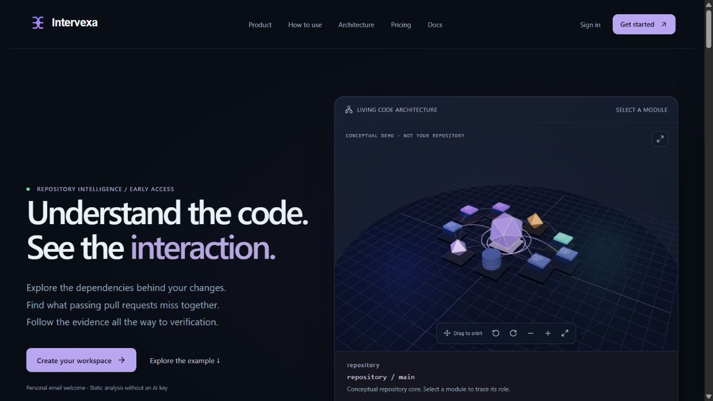
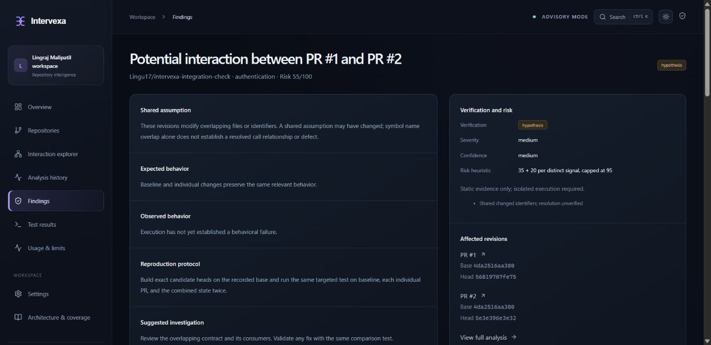
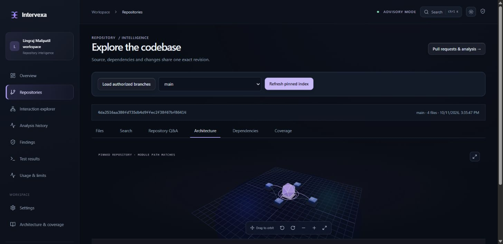
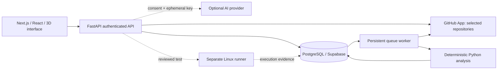

<div align="center">


# Understand the code. See the interaction.

**A 3D developer workspace for revision-pinned source, dependency exploration, and pull-request interaction analysis.**

[Live application](https://intervexa-web.onrender.com/) · [How to use](https://intervexa-web.onrender.com/#how-to-use) · [Architecture](docs/architecture.md) · [Test evidence](docs/github-integration-report.md)

**Next.js · TypeScript · React Three Fiber · FastAPI · PostgreSQL · GitHub Apps**

</div>



*Real application screenshot. The public architecture scene is a labeled conceptual example; connected repository views use indexed source. Interactive orbit, zoom, selection and fullscreen are available in the live app.*

## The problem worth solving

Two pull requests can each pass their own tests and still break a shared assumption when combined. Intervexa brings the code, pending changes, and verification evidence into one workspace so a developer can inspect that interaction before merging.

It is an early-access engineering project: static results are advisory hypotheses, not automatic proof of a defect.

## A two-minute product tour

1. **Connect** selected GitHub repositories through the read-only GitHub App.
2. **Index** a branch at an exact commit and explore its 3D module map.
3. **Search** indexed files, Python symbols and identifiers with source-line references.
4. **Sync and select** 2–10 open pull requests to analyze shared files, identifiers and Python contract changes.
5. **Review** findings, pinned revisions and coverage. Experimental verification requires a reviewed test and a separate isolated runner.

| Capability | What it demonstrates |
| --- | --- |
| Spatial code explorer | Custom Three.js geometry, curved relationships, demand rendering, orbit/zoom/fullscreen, keyboard controls and an isometric fallback |
| Repository intelligence | Bounded concurrent fetching, Python AST symbols/imports, exact-commit source and lexical retrieval |
| PR interaction analysis | Scoped signature/return-key comparison, bounded pair selection, immutable snapshots and explicit uncertainty |
| Reliable background work | Persistent database queue, deduplication, bounded retries, leases, cancellation and stale-revision detection |
| Secure account workflows | Google/GitHub OAuth, explicit identity linking, Argon2 passwords, opaque hashed sessions, origin/CSRF and tenant checks |
| Optional BYOK assistance | Ephemeral provider keys, consent-bound source excerpts, citation checks and optional semantic embeddings |
| Practical workspace | Analysis history, findings, execution evidence, usage, profile, appearance, audit and export |

## Real GitHub workflow, not a seeded demo

A dedicated private repository was created, pushed and pulled from this account. Two real open PRs provide a controlled response-key regression:

| State | Observed local behavior |
| --- | --- |
| Baseline | Pass |
| PR #1: rename `token` to `session` | Pass independently |
| PR #2: add a `token` consumer | Pass independently |
| Combined revisions | Repeatable `KeyError: 'token'` |

The deployed application discovered the repository, synchronized both PRs, and produced a source-grounded potential interaction identifying the removed `token` return key. A real push also invalidated the old snapshot and automatically triggered fresh analysis. The hosted result correctly remained **inconclusive** because its isolated runner is not configured. Local execution is separate evidence, not a claim of hosted sandbox verification.



## Engineering evidence



*The private integration fixture indexed four files at its exact baseline SHA; source search and Python import relationships were verified through the deployed application.*

| Check | Latest result |
| --- | --- |
| Backend regression suite | **182 passed** |
| Browser workflows | **11 passed** |
| Named acceptance scenarios | **100 / 100 passed** |
| Repeated controlled Git-state runs | **100 / 100 matched expected behavior**: 75 isolated-state passes, 25 intentional combined-state failures |
| TypeScript, ESLint and production build | Passed in the validated release; CI checks every push |
| Live integrations | Google sign-in, GitHub App discovery, PR sync, pinned indexing and static analysis verified |

The 100 scenarios exposed 11 initial failures that were fixed: signature distinctions, file/scope matching, nested return isolation and malformed runner evidence. Counts establish behavior on defined examples; they do not imply 100% general AI accuracy. See the [acceptance report](docs/acceptance-report.md) and [real GitHub report](docs/github-integration-report.md).

## Architecture and design choices



- **Evidence before certainty:** risk scores prioritize human review; unverified relationships stay labeled.
- **Responsiveness without stale identity:** immediate workspace shell, short-lived tab-memory caching and cache invalidation on mutation/logout/401.
- **Bounded work:** four parallel pinned-file requests, 60 indexed files, 50 KB per file and 500 KB source total.
- **Separate execution boundary:** repository code never executes on the API host.
- **Honest failure states:** unavailable runners, missing providers and temporary service failures surface recovery guidance instead of fabricated results.

## Run and explore

The hosted application needs no local installation: [open Intervexa](https://intervexa-web.onrender.com/login). Static exploration and analysis need no paid AI key. Free Render hosting can sleep and cause cold-start delays.

For local development, use **Node 24, Python 3.14 and Git**. The full commands, configuration and supported scope are below.

## Current scope

Python static contracts and module-path imports are supported. Dynamic calls, fully resolved cross-language dependency graphs, higher-order PR interactions, SQL migration semantics, email recovery/delivery and multi-owner workspaces remain unfinished. Production AI and isolated execution require separately configured services. There is no uptime, compliance or universal accuracy claim.

This repository is private. Recruiters need repository access to inspect the source; the live homepage remains shareable.

<details>
<summary><strong>Developer handbook — local setup, integrations, validation and security</strong></summary>

## Run locally (Windows PowerShell)

Requires Node 24, Python 3.14, and Git. No paid service is required for application startup.

```powershell
npm ci
python -m venv .venv
.\.venv\Scripts\python -m pip install -r backend\requirements.lock.txt
Copy-Item .env.example .env.local
Copy-Item backend\.env.example backend\.env
Set-Location backend
..\.venv\Scripts\python -m alembic upgrade head
..\.venv\Scripts\python -m uvicorn app.main:app --host 127.0.0.1 --port 8000 --no-access-log
```

In a second terminal from the project root:

```powershell
npm run dev
```

Open **http://localhost:3000** or **http://127.0.0.1:3000**. Both exact local aliases at the configured port are allowed in development; production requires exact HTTPS origins. Register with any valid personal email. There is no seeded repository or default credential; conceptual public previews are labeled. SQLite is local-only. For PostgreSQL, supply `DATABASE_URL=postgresql+psycopg://...`; `compose.yaml` can create a local database when Docker is available, with a password you supply via environment.

## Repository intelligence and account setup

From a connected repository, select **Explore code & architecture**, load authorized branches and index one. Browse pinned source/symbols, search paths/identifiers, inspect Python module imports and review explicit coverage. Optional semantic retrieval creates bounded OpenAI vectors only with paid consent. Repository Q&A retrieves four source excerpts and rejects invalid path/line citations; interpretation still needs review. No index or AI workflow executes repository code.

Google/GitHub social sign-in reuses secure database sessions and requires owner-configured client credentials. Existing-email collisions require authenticated account linking. Password recovery/email verification remain unavailable without a verified delivery service. Account settings provide profile/workspace editing, initials avatars, a bounded JSON export and confirmed personal account deletion. The public contact form stores real submissions, with validation, spam/rate controls and 90-day retention. Optional Resend team notifications use a durable queue with bounded retries and idempotency; see [email setup](docs/contact-email.md).

See [exact OAuth/GitHub/provider configuration](docs/integrations.md), [architecture](docs/architecture.md) and [troubleshooting](docs/troubleshooting.md). Secret values belong in backend/hosting settings, never chat or frontend public variables.

## GitHub App setup

Create or use an owner-authorized GitHub App. Set callback URL `http://localhost:3000/api/github/callback` for local development (HTTPS frontend origin in production). Set its post-installation setup URL to frontend `/app/repositories`; authorize the account again after installing. Configure backend `/api/github/webhook` as the webhook URL; local webhooks require an owner-authorized HTTPS tunnel. Subscribe to pull requests, pushes, installation changes, and installation repository changes.

Permissions: metadata/read, contents/read, pull requests/read; organization members/read is required to verify organization administrator authority. Checks/write is optional and needed only when explicitly enabling advisory Check publication. Set `GITHUB_APP_ID`, `GITHUB_APP_SLUG`, `GITHUB_CLIENT_ID`, `GITHUB_CLIENT_SECRET`, `GITHUB_WEBHOOK_SECRET`, `GITHUB_PRIVATE_KEY_PATH`, and a random >=32-character `SESSION_SECRET` in `backend/.env`. Use a private key path outside Git. GitHub installation IDs are attached only after a verified user authorization; personal account ownership or active organization-admin membership is required. One installation cannot be attached to multiple Intervexa workspaces in this release.

Install the app on selected repositories, authorize your account, discover accessible repositories, connect one, sync its PRs, and create an analysis. Only exact base/head SHAs are analyzed. Ingestion supports at most 50 open PRs, 100 files and 500 KB diff metadata per PR. A changeset moving during ingestion is rejected.

Select two to ten PRs before starting a manual analysis. GitHub Checks are disabled by default: enable GITHUB_PUBLISH_CHECKS and opt in through repository policy before publication. Checks stay advisory.

## Analysis and verification

Next.js → authenticated FastAPI → PostgreSQL/SQLite persistent queue → GitHub snapshots → deterministic Python AST analysis → bounded pair hypotheses → reviewed targeted test → optional separate Linux runner → persisted evidence → advisory Checks.

Static pair selection scores `min(95, 35 + 20 × distinct evidence signals)`. Shared files and at least two shared changed identifiers are current signals. Python function signatures and dictionary return keys are compared; names are not a fully resolved call graph. Unsupported/omitted files are reported. Existing exact-revision contents are cached within a run; equivalent manually queued snapshots are deduplicated. Background work has three bounded attempts and a 10-minute timeout, with lease recovery and cancellation/stale checks. Repository policies bound pairs and retention.

Findings begin **suspected**. From a finding, provide a real Python unittest or explicitly request an AI draft, review it, then run a comparison through the separate runner. Reproduction requires baseline and both individual states to pass, then identical assertion failures in two combined runs. Baseline/import/environment failures, timeouts, missing runner, and merge conflicts are **inconclusive**. Passing combined tests are **not reproduced**. Full root-cause attribution and suggested fixes require human review.

The runner supports public repositories and Python stdlib tests only. Automatic AI generation requires unittest imports observed in pinned repository tests; unknown or unsupported frameworks require a reviewed manual test. See [runner setup](runner/README.md). Never execute repository code on the API host. This Windows workstation has no rootless Podman execution environment.

## BYOK

OpenAI and OpenRouter support authenticated connection tests and metadata-derived model selectors. Keys exist only in frontend/backend request memory. Only provider/model/token preferences are persisted. A refresh requires re-entering the key. No localStorage/sessionStorage, plaintext key column, shared paid credential, automatic provider switching, or default generation occurs. Generation sends bounded code excerpts only after explicit consent. The output token cap does not cap total billable input usage. Provider terms and quotas apply.

Adapters use [OpenAI model listing](https://developers.openai.com/api/reference/resources/models/methods/list), Responses with `store:false`, and [OpenRouter authenticated key inspection](https://openrouter.ai/docs/api/api-reference/api-keys/get-current-api-key) plus model listing. Listing metadata does not guarantee model text-generation compatibility or remaining quota. Tests mock upstream HTTP; live validation requires a real supplied key.

## Validation

```powershell
npm run typecheck
npm run lint
npm run build
npm audit
Set-Location backend
..\.venv\Scripts\python -m ruff check app migrations tests
..\.venv\Scripts\python -m pytest -q
```

With both servers running, from root:

```powershell
npx playwright install chromium
npm run test:e2e
```

Browser tests create clearly identified local test accounts only, and use controlled HTTP fixtures for unavailable providers. They do not simulate successful live GitHub authorization. CI runs build, API/security/migration tests, and browser smoke tests.

## Security and current limitations

Argon2 passwords, hashed opaque database sessions, HTTP-only cookies, CSRF header checks, exact allowed origin, body limits, tenant authorization, parameterized ORM access, webhook HMAC/delivery deduplication, fixed provider/GitHub origins, provider error redaction, and audit events are implemented. Production refuses SQLite, missing session secret, or non-HTTPS origins. Keep proxy access logs off callback queries. In-memory request limits are per-process; use one process until a shared limiter is added.

This is **not a completed production SaaS**. Email verification/recovery, invitations/SSO, higher-order combinations, cross-language resolved contracts, SQL migration semantics, private-repository runner access, dependency installation, automatic causal attribution, and high-assurance hostile-code isolation remain unfinished. No SOC 2, penetration test, trademark clearance, domain availability, or uptime guarantee is claimed. Frontend/backend deployment, PostgreSQL readiness and live account/repository workflows are verified.

See [engineering status](docs/STATUS.md), [deployment and free-tier assessment](docs/deployment.md), and [brand guide](docs/brand-guidelines.md). Open [the live application](https://intervexa-web.onrender.com/login) and sign in with Google or GitHub. Both access the owner workspace after explicit linking. The backend and Supabase migrations are live; repository indexing and architecture work. Free services can cold start. Email recovery/delivery, live AI and isolated execution remain unavailable until their required services are configured.

</details>
